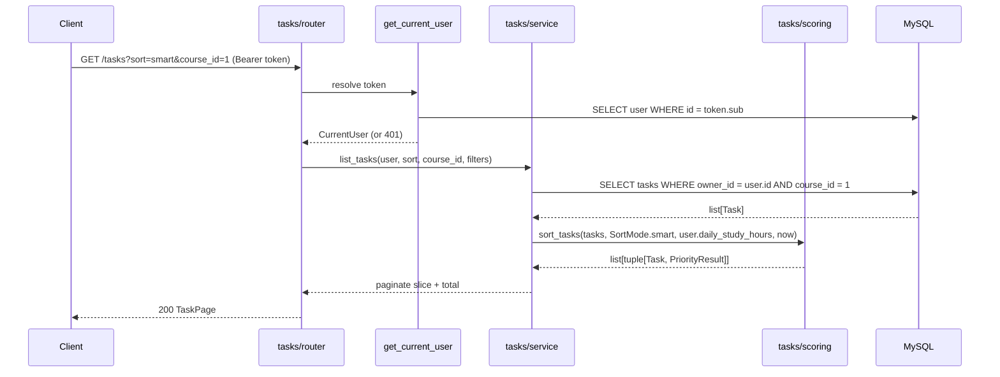

# Milestone 1 Backend — Implementation

**Feature folder:** `specs/feature/2026-11-17-milestone-1-backend/`  
**Milestone:** M1 (see [`specs/roadmap.md`](file:///C:/Users/merss/Documents/Smart%20Student%20Task%20Prioritization%20Queue%20System/specs/roadmap.md))  
**Governed by:** [`specs/constitution.md`](file:///C:/Users/merss/Documents/Smart%20Student%20Task%20Prioritization%20Queue%20System/specs/constitution.md) and [`specs/tech-stack.md`](file:///C:/Users/merss/Documents/Smart%20Student%20Task%20Prioritization%20Queue%20System/specs/tech-stack.md)

---

## 1. Stack & Tooling
- **Language / Environment:** Python 3.12 managed via **uv** (`pyproject.toml` + `uv.lock`). Every command runs as `uv run <command>`.
- **Framework:** FastAPI with Pydantic v2.
- **ORM & DB Access:** SQLAlchemy 2.0 (synchronous style with plain `def` endpoints).
- **Database:** MySQL 8.0 (InnoDB, utf8mb4) via PyMySQL and `cryptography`.
- **Migrations:** Alembic with native MySQL DDL execution.
- **Authentication & Security:** PyJWT (HS256), `pwdlib[argon2]`, OAuth2PasswordBearer flow.
- **Testing:** pytest with `httpx` (`TestClient`) executing against a dedicated `taskqueue_test` MySQL database.

### One-Time MySQL Setup (Owner Prerequisite)
Execute once in MySQL Workbench or via `mysql.exe` as root:
```sql
CREATE DATABASE taskqueue      CHARACTER SET utf8mb4 COLLATE utf8mb4_0900_ai_ci;
CREATE DATABASE taskqueue_test CHARACTER SET utf8mb4 COLLATE utf8mb4_0900_ai_ci;
CREATE USER 'taskqueue'@'localhost' IDENTIFIED BY 'taskqueue_password';
GRANT ALL PRIVILEGES ON taskqueue.*      TO 'taskqueue'@'localhost';
GRANT ALL PRIVILEGES ON taskqueue_test.* TO 'taskqueue'@'localhost';
FLUSH PRIVILEGES;
```

---

## 2. Architecture & File Structure
```
app/
  main.py                 # FastAPI application root, registers feature routers
  core/
    config.py             # pydantic-settings: SECRET_KEY, DATABASE_URL, ACCESS_TOKEN_EXPIRE_DAYS
    database.py           # engine, SessionLocal, Base, get_db, UTCDateTime TypeDecorator
    security.py           # Argon2 password hashing, JWT creation and decoding
  auth/
    router.py             # /auth/register, /auth/login
    dependencies.py       # get_current_user (single auth gateway, Constitution S-1)
  users/
    models.py             # User model
    schemas.py            # UserCreate, UserRead, UserUpdate, Token
    router.py             # /users/me (GET, PATCH, DELETE)
  courses/
    models.py             # Course model
    schemas.py            # CourseCreate, CourseUpdate, CourseRead
    service.py            # Course persistence and ownership verification
    router.py             # /courses (CRUD)
  tasks/
    models.py             # Task model, TaskCategory enum
    schemas.py            # TaskCreate, TaskUpdate, TaskRead, PriorityRead, TaskPage, SortMode
    scoring.py            # Pure function priority engine (no DB, no FastAPI)
    service.py            # Task queries, course attachment check, scoring orchestration
    router.py             # /tasks (CRUD, queue listing, top tasks)
alembic/
  env.py                  # Targets Base.metadata, uses settings.database_url
  versions/               # Generated migration scripts
tests/
  conftest.py             # Test database lifecycle, automatic table truncating, auth helpers
  helpers.py              # Payload generators (task_payload, course_payload)
  test_core.py            # Settings validation, UTCDateTime converter tests
  test_scoring.py         # Pure mathematical priority and sorting unit tests
  test_auth.py            # Registration, login (username/email), token validation
  test_users.py           # /users/me profile management and account deletion
  test_courses.py         # Course CRUD and hex color validation
  test_tasks_crud.py      # Task CRUD, course attachment, completion toggles
  test_tasks_queue.py     # Queue ordering (deadline/smart), course filtering, pagination
  test_isolation.py       # Cross-tenant IDOR security verification (404 masking)
  test_migrations.py      # Alembic upgrade/downgrade schema verification
```

---

## 3. Database Schema (MySQL 8, InnoDB, utf8mb4)

### `users`
| Column | Type | Constraints / Description |
|---|---|---|
| `id` | INT | Primary Key, Auto-increment |
| `username` | VARCHAR(50) | Unique Index, Not Null. Lowercased handle (3–50 chars) |
| `email` | VARCHAR(320) | Unique Index, Not Null. Lowercased student email |
| `hashed_password` | VARCHAR(255) | Not Null. Argon2 password hash |
| `daily_study_hours` | DOUBLE | Not Null, Default: 3.0. Valid range: 0.5 to 16.0 |
| `created_at` | DATETIME(6) | Not Null, UTC |

*Relationship:* `courses` and `tasks` cascade delete (`cascade="all, delete-orphan", passive_deletes=True`).

### `courses`
| Column | Type | Constraints / Description |
|---|---|---|
| `id` | INT | Primary Key, Auto-increment |
| `owner_id` | INT | Foreign Key (`users.id` `ON DELETE CASCADE`), Indexed, Not Null |
| `name` | VARCHAR(100) | Not Null (e.g., "Software Engineering") |
| `code` | VARCHAR(20) | Not Null (e.g., "CS 401") |
| `color` | VARCHAR(7) | Not Null, Default: "#3B82F6". Hex regex: `^#[0-9A-Fa-f]{6}$` |
| `created_at` | DATETIME(6) | Not Null, UTC |
| `updated_at` | DATETIME(6) | Not Null, UTC |

*Relationship:* `tasks` back-populates `course`.

### `tasks`
| Column | Type | Constraints / Description |
|---|---|---|
| `id` | INT | Primary Key, Auto-increment |
| `owner_id` | INT | Foreign Key (`users.id` `ON DELETE CASCADE`), Indexed, Not Null |
| `course_id` | INT | Foreign Key (`courses.id` `ON DELETE SET NULL`), Indexed, Nullable |
| `title` | VARCHAR(200) | Not Null, Stripped string (1–200 chars) |
| `description` | TEXT | Nullable (Max 2000 chars) |
| `category` | VARCHAR(20) | Not Null. Check Constraint: `quiz, homework, project, exam, other` |
| `due_at` | DATETIME(6) | Not Null, UTC |
| `grade_weight` | DOUBLE | Not Null (0.0 to 100.0) |
| `estimated_hours` | DOUBLE | Not Null (>0.0, ≤500.0) |
| `difficulty` | INT | Not Null (1 to 5) |
| `completed` | TINYINT(1) | Not Null, Default: 0 |
| `completed_at` | DATETIME(6) | Nullable, UTC |
| `created_at` | DATETIME(6) | Not Null, UTC |
| `updated_at` | DATETIME(6) | Not Null, UTC |

---

## 4. Priority Engine (`tasks/scoring.py`)

All prioritization calculations are implemented as **pure functions** accepting an injected `now: datetime` and `daily_study_hours: float`. No database queries or framework state are accessed.

```python
def compute_priority(task: ScorableTask, daily_study_hours: float, now: datetime) -> PriorityResult | None:
    if task.completed:
        return None

    hours_until_due = (task.due_at - now).total_seconds() / 3600.0

    if hours_until_due <= 0:
        time_pressure = 1.0
    else:
        available_study_hours = (hours_until_due / 24.0) * daily_study_hours
        time_pressure = min(task.estimated_hours / available_study_hours, 1.0)

    impact = min(task.grade_weight / 50.0, 1.0)
    difficulty_factor = (task.difficulty - 1) / 4.0
    score = 100.0 * (0.50 * time_pressure + 0.35 * impact + 0.15 * difficulty_factor)

    return PriorityResult(
        score=score,
        time_pressure=time_pressure,
        impact=impact,
        difficulty_factor=difficulty_factor,
        hours_until_due=hours_until_due,
        urgent=(hours_until_due <= 24.0),
        overdue=(hours_until_due < 0),
    )
```

### Sorting Rules
1. **Incomplete vs Completed:** Incomplete tasks are ALWAYS sorted before completed tasks.
2. **Deadline Sort (`SortMode.deadline`):**
   - Incomplete: `due_at ASC`, then `id ASC`.
   - Completed: `completed_at DESC`, then `id ASC`.
3. **Smart Sort (`SortMode.smart`):**
   - Incomplete: `score DESC`, then `due_at ASC`, then `id ASC`.
   - Completed: `completed_at DESC`, then `id ASC`.

---

## 5. API Contracts

All protected routes require header: `Authorization: Bearer <token>`.

### Auth & User Endpoints
```jsonc
// POST /auth/register
// Request:
{ "username": "alex24", "email": "alex@school.edu", "password": "securePassword123" }
// Response 201:
{ "id": 1, "username": "alex24", "email": "alex@school.edu", "daily_study_hours": 3.0, "created_at": "2026-11-17T12:00:00Z" }

// POST /auth/login
// Request Form: username=alex24&password=securePassword123 (or username=alex@school.edu)
// Response 200:
{ "access_token": "eyJhbGciOi...", "token_type": "bearer" }

// GET /users/me -> 200 UserRead
// PATCH /users/me -> Request: { "daily_study_hours": 4.5 } -> 200 UserRead
// DELETE /users/me -> 204 No Content
```

### Course Endpoints
```jsonc
// POST /courses
// Request:
{ "name": "Introduction to Computer Science", "code": "CS101", "color": "#3B82F6" }
// Response 201:
{
  "id": 1,
  "name": "Introduction to Computer Science",
  "code": "CS101",
  "color": "#3B82F6",
  "created_at": "2026-11-17T12:00:00Z",
  "updated_at": "2026-11-17T12:00:00Z"
}

// GET /courses -> 200 list[CourseRead]
// GET /courses/{id} -> 200 CourseRead (or 404)
// PATCH /courses/{id} -> Request: { "name": "CS I: Honors" } -> 200 CourseRead
// DELETE /courses/{id} -> 204 No Content
```

### Task Endpoints
```jsonc
// POST /tasks
// Request:
{
  "title": "Build Parser Milestone",
  "description": "Implement lexical analyzer and syntax tree",
  "course_id": 1, // optional, null allowed
  "category": "project",
  "due_at": "2026-12-01T12:00:00Z",
  "grade_weight": 30.0,
  "estimated_hours": 20.0,
  "difficulty": 4,
  "completed": false
}
// Response 201:
{
  "id": 10,
  "title": "Build Parser Milestone",
  "description": "Implement lexical analyzer and syntax tree",
  "course": {
    "id": 1,
    "code": "CS101",
    "name": "Introduction to Computer Science",
    "color": "#3B82F6"
  },
  "category": "project",
  "due_at": "2026-12-01T12:00:00Z",
  "grade_weight": 30.0,
  "estimated_hours": 20.0,
  "difficulty": 4,
  "completed": false,
  "completed_at": null,
  "created_at": "2026-11-17T12:00:00Z",
  "updated_at": "2026-11-17T12:00:00Z",
  "priority": {
    "score": 56.1,
    "time_pressure": 0.476,
    "impact": 0.600,
    "difficulty_factor": 0.750,
    "hours_until_due": 336.000,
    "urgent": false,
    "overdue": false
  }
}

// GET /tasks?sort=smart&course_id=1&limit=50&offset=0
// Response 200:
{
  "items": [ /* list of TaskRead */ ],
  "total": 1,
  "limit": 50,
  "offset": 0
}

// GET /tasks/top?n=3 -> Response 200 list[TaskRead] (top incomplete by smart sort)
// GET /tasks/{id} -> 200 TaskRead (or 404)
// PATCH /tasks/{id} -> Request: { "completed": true } -> 200 TaskRead (completed_at set, priority null)
// DELETE /tasks/{id} -> 204 No Content
```

---

## 6. Control Flow Sequence

### `GET /tasks?sort=smart&course_id=1`


---

## 7. Failure Handling & HTTP Exceptions

| Scenario | HTTP Status | Detail Message |
|---|---|---|
| Missing, invalid, or expired Bearer token | `401 Unauthorized` | `{"detail": "Could not validate credentials"}` + `WWW-Authenticate: Bearer` |
| Invalid login credentials | `401 Unauthorized` | `{"detail": "Incorrect username/email or password"}` |
| Token belongs to deleted user | `401 Unauthorized` | `{"detail": "Could not validate credentials"}` |
| Duplicate username on register | `409 Conflict` | `{"detail": "Username already taken"}` |
| Duplicate email on register | `409 Conflict` | `{"detail": "Email already registered"}` |
| Course not found OR owned by other user | `404 Not Found` | `{"detail": "Course not found"}` |
| Task not found OR owned by other user | `404 Not Found` | `{"detail": "Task not found"}` |
| Attaching foreign `course_id` to a task | `404 Not Found` | `{"detail": "Course not found"}` |
| Invalid hex color (e.g. "blue") | `422 Unprocessable` | Pydantic regex validation error |
| Naive datetime without timezone offset | `422 Unprocessable` | Pydantic AwareDatetime error |
| Out of bounds values (difficulty 6, hours 0) | `422 Unprocessable` | Pydantic bounds validation error |

---

## 8. Migrations & Test Database Strategy
1. **Alembic Migration:** A single migration (`<rev>_create_users_courses_tasks.py`) declares all tables, column types (`DOUBLE`, `DATETIME(6)`), indices, check constraints, and foreign key cascades.
2. **Guarded Test Database:** `conftest.py` reads `TEST_DATABASE_URL` and strictly verifies `db_name.endswith("_test")` to prevent data destruction.
3. **Session Setup:** The test runner runs `alembic upgrade head` on `taskqueue_test` once per test session.
4. **Table Cleaning:** An autouse pytest fixture executes `DELETE FROM tasks; DELETE FROM courses; DELETE FROM users;` before every test function, ensuring 100% test isolation with zero state bleed.
