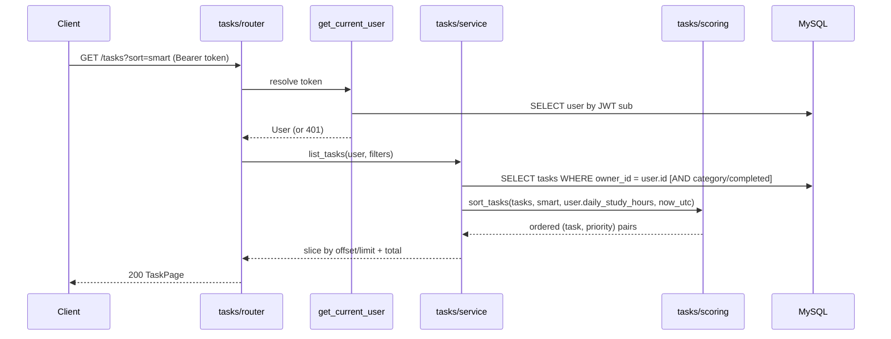

# Milestone 1 Backend — Implementation

**Feature folder:** `specs/feature/2026-11-17-milestone-1-backend/` · **Milestone:** M1 (see `specs/roadmap.md`) · **Governed by:** `specs/constitution.md`

## 1. Stack & Tooling
- Python **3.12** via **uv** (`pyproject.toml` + `uv.lock`); everything runs through `uv run`.
- Runtime deps: `fastapi[standard]`, `sqlalchemy>=2.0`, `alembic`, `pymysql`, `cryptography`, `pydantic-settings`, `pyjwt`, `pwdlib[argon2]`, `email-validator`.
- Dev deps: `pytest`, `httpx`.
- Run: `uv run fastapi dev app/main.py` → `http://127.0.0.1:8000/docs`.
- `git init` with a Python `.gitignore` (`.env`, `.venv/`, `__pycache__/`, `.pytest_cache/`); commit `.env.example`.

### One-time MySQL setup (manual; runbook in validation.md §4)
The `mysql` CLI isn't on PATH, so run this in MySQL Workbench or with the full path to `mysql.exe`, as root:
```sql
CREATE DATABASE taskqueue      CHARACTER SET utf8mb4 COLLATE utf8mb4_0900_ai_ci;
CREATE DATABASE taskqueue_test CHARACTER SET utf8mb4 COLLATE utf8mb4_0900_ai_ci;
CREATE USER 'taskqueue'@'localhost' IDENTIFIED BY '<choose-a-password>';
GRANT ALL PRIVILEGES ON taskqueue.*      TO 'taskqueue'@'localhost';
GRANT ALL PRIVILEGES ON taskqueue_test.* TO 'taskqueue'@'localhost';
```

## 2. Architecture (Router → Service → Scoring/Persistence), split by feature
```
app/
  main.py                 # FastAPI app, include routers
  core/
    config.py             # Settings: SECRET_KEY, DATABASE_URL, ACCESS_TOKEN_EXPIRE_DAYS
    database.py           # engine (pool_pre_ping), SessionLocal, Base, get_db, UTCDateTime type
    security.py           # hash_password, verify_password, create_access_token, decode_access_token
  auth/
    router.py             # /auth/register, /auth/login
    dependencies.py       # get_current_user (the ONLY auth gateway)
  users/
    models.py             # User
    schemas.py            # UserCreate, UserRead, UserUpdate, Token
    router.py             # /users/me GET, PATCH, DELETE
  tasks/
    models.py             # Task, TaskCategory enum
    schemas.py            # TaskCreate, TaskUpdate, TaskRead, PriorityRead, TaskPage, SortMode
    scoring.py            # pure: compute_priority, sort_tasks (no DB, no FastAPI)
    service.py            # owner-scoped queries + calls into scoring
    router.py             # /tasks endpoints
alembic/ + alembic.ini    # env.py reads DATABASE_URL from Settings; target Base.metadata
tests/
  conftest.py             # guarded test DB, migrate once, clean tables per test, client, auth helpers
  test_scoring.py  test_auth.py  test_users.py  test_tasks_crud.py  test_tasks_queue.py  test_isolation.py  test_migrations.py
```
`scoring.py` stays pure so Milestone 3 can put a model behind the same `compute_priority` interface.

## 3. Configuration (`.env`)
| Setting | Default | Notes |
|---|---|---|
| `SECRET_KEY` | *(required)* | missing → startup error |
| `DATABASE_URL` | *(required)* | e.g. `mysql+pymysql://taskqueue:<pw>@localhost:3306/taskqueue?charset=utf8mb4` |
| `TEST_DATABASE_URL` | *(required for pytest)* | same, ending in `/taskqueue_test?...` |
| `ACCESS_TOKEN_EXPIRE_DAYS` | `7` | |

## 4. Data Model (MySQL 8, InnoDB, utf8mb4)

### `users`
| Column | SQLAlchemy → MySQL | Constraints |
|---|---|---|
| id | Integer → INT | PK, auto-increment |
| email | String(320) → VARCHAR(320) | unique index; stored lowercase |
| hashed_password | String(255) → VARCHAR(255) | NOT NULL |
| daily_study_hours | Double → DOUBLE | NOT NULL, default 3.0; API range 0.5–16 |
| created_at | UTCDateTime → DATETIME(6) | NOT NULL |

### `tasks`
| Column | SQLAlchemy → MySQL | Constraints |
|---|---|---|
| id | Integer → INT | PK, auto-increment |
| owner_id | Integer → INT | FK `users.id` `ON DELETE CASCADE`, indexed, NOT NULL |
| title | String(200) → VARCHAR(200) | NOT NULL; stripped, 1–200 chars |
| description | Text → TEXT | nullable; ≤2000 chars at the API |
| category | Enum(TaskCategory, native_enum=False) → VARCHAR(20) + CHECK | `quiz, homework, project, exam, other` |
| due_at | UTCDateTime → DATETIME(6) | NOT NULL |
| grade_weight | Double → DOUBLE | 0–100 inclusive |
| estimated_hours | Double → DOUBLE | >0, ≤500 |
| difficulty | Integer → INT | 1–5 |
| completed | Boolean → TINYINT(1) | NOT NULL, default false |
| completed_at | UTCDateTime → DATETIME(6) | nullable; set on completed→true, cleared on →false |
| created_at / updated_at | UTCDateTime → DATETIME(6) | NOT NULL, set by the app |

Notes:
- **`Double`, not `Float`:** SQLAlchemy `Float` maps to MySQL's 4-byte `FLOAT`, which turns `12.3` into `12.300000190734863`.
- **`UTCDateTime`** is a `TypeDecorator` over `DATETIME(fsp=6)`: converts aware datetimes to naive UTC on write and re-attaches UTC on read, because MySQL `DATETIME` has no timezone.
- `User.tasks` uses `cascade="all, delete-orphan", passive_deletes=True` on top of the DB-level `ON DELETE CASCADE` (D-3).
- Pydantic `AwareDatetime` for `due_at`: input with no offset → `422` (D-4).

## 5. Priority Engine (`tasks/scoring.py`)
```python
def compute_priority(task, daily_study_hours: float, now: datetime) -> PriorityResult | None
def sort_tasks(tasks, mode: SortMode, daily_study_hours: float, now: datetime) -> list[tuple[Task, PriorityResult | None]]
```
`now` is always passed in (tests freeze time). Returns `None` for completed tasks.

```
hours_until_due  = (due_at - now) in hours            # negative if overdue
if hours_until_due <= 0:
    time_pressure = 1.0
else:
    available     = (hours_until_due / 24) * daily_study_hours
    time_pressure = min(estimated_hours / available, 1.0)
impact            = min(grade_weight / 50, 1.0)
difficulty_factor = (difficulty - 1) / 4               # 1→0.0 … 5→1.0 
score             = 100 * (0.50*time_pressure + 0.35*impact + 0.15*difficulty_factor)
overdue           = hours_until_due < 0
urgent            = hours_until_due <= 24              # includes overdue
```
Weights and the 50% impact cap are module-level constants. Responses round `score` to 1 decimal and factors and `hours_until_due` to 3 decimals; sorting uses unrounded values.

**Ordering** (incomplete always before completed):
- `deadline`: `due_at` asc, then `id` asc.
- `smart`: `score` desc, then `due_at` asc, then `id` asc.
- Completed group: `completed_at` desc, then `id` asc.

## 6. API Contract
Protected routes need `Authorization: Bearer <token>`.

| Method | Path | Body / Query | Success | Errors |
|---|---|---|---|---|
| POST | `/auth/register` | `{email, password}` (password 8–128 chars) | `201 UserRead` | 409, 422 |
| POST | `/auth/login` | form: `username`, `password` | `200 {access_token, token_type}` | 401 |
| GET | `/users/me` | — | `200 UserRead` | 401 |
| PATCH | `/users/me` | `{daily_study_hours}` | `200 UserRead` | 401, 422 |
| DELETE | `/users/me` | — | `204` | 401 |
| POST | `/tasks` | `TaskCreate` | `201 TaskRead` | 401, 422 |
| GET | `/tasks` | `sort, category, completed, limit, offset` | `200 TaskPage` | 401, 422 |
| GET | `/tasks/top` | `n` (1–10, default 3), `sort` (default **smart**) | `200 list[TaskRead]` (incomplete only) | 401, 422 |
| GET | `/tasks/{id}` | — | `200 TaskRead` | 401, 404 |
| PATCH | `/tasks/{id}` | `TaskUpdate` (all optional; explicit `null` only for `description`) | `200 TaskRead` | 401, 404, 422 |
| DELETE | `/tasks/{id}` | — | `204` | 401, 404 |

`/tasks/top` is declared before `/tasks/{id}`. PATCH only, no PUT.

```jsonc
// UserRead
{ "id": 1, "email": "ana@school.edu", "daily_study_hours": 3.0, "created_at": "2026-11-17T11:00:00Z" }

// TaskRead
{
  "id": 7, "title": "Capstone project", "description": null, "category": "project",
  "due_at": "2026-12-01T12:00:00Z", "grade_weight": 30.0, "estimated_hours": 20.0,
  "difficulty": 4, "completed": false, "completed_at": null,
  "created_at": "...", "updated_at": "...",
  "priority": {                       // null when completed
    "score": 56.1, "time_pressure": 0.476, "impact": 0.6, "difficulty_factor": 0.75,
    "hours_until_due": 336.0, "urgent": false, "overdue": false
  }
}

// TaskPage — GET /tasks (envelope so the frontend can paginate)
{ "items": [TaskRead], "total": 12, "limit": 50, "offset": 0 }
```
Filtering happens in SQL (owner, category, completed). Scoring, sorting and slicing happen in Python, so both sort modes share one code path.

## 7. Control Flow — `GET /tasks?sort=smart`


## 8. Failure Handling
| Condition | Response |
|---|---|
| Missing / malformed / expired token, or token for a deleted user | `401` + `WWW-Authenticate: Bearer` |
| Task not found **or** owned by another user | `404 {"detail": "Task not found"}` |
| Duplicate email (any case) | `409 {"detail": "Email already registered"}` |
| Wrong email or password | `401 {"detail": "Incorrect email or password"}` |
| Out-of-range field, bad enum, naive datetime, blank title | `422` |
| Database unreachable | unhandled → `500` (no custom handling in M1) |

## 9. Migrations
Alembic `env.py` reads `DATABASE_URL` from Settings (or an override passed by the test harness) and targets `Base.metadata`. One initial revision creates `users` and `tasks`, including the FK cascade and the category CHECK. No batch mode needed: MySQL supports `ALTER TABLE` natively.

## 10. Test Database Strategy
- `conftest.py` reads `TEST_DATABASE_URL` and **refuses to run unless the database name ends in `_test`**, so a real database can never be wiped.
- Once per session: drop all tables (including `alembic_version`) in `taskqueue_test`, then run `alembic upgrade head`. Tests use the *migrated* schema, which also proves the migrations match the models. No `create_all` at all.
- Before each test: `DELETE FROM tasks; DELETE FROM users;`.
- `get_db` is overridden to use the test engine. Time-dependent tests call `scoring` with a fixed `now`; API tests use due dates relative to the real current time.
