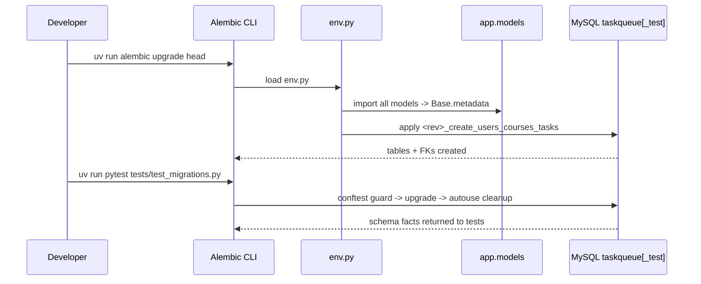

# Day 2 — Database Models & Migration Harness — Implementation

**Feature folder:** `specs/feature/2026-11-19-day2-models-migrations/`  
**Milestone:** M1 (see [`specs/roadmap.md`](specs/roadmap.md))  
**Governed by:** [`specs/constitution.md`](specs/constitution.md) and [`specs/tech-stack.md`](specs/tech-stack.md)

---

## 1. Stack & Tooling
Python 3.12 via uv; FastAPI project scaffold from Day 1; SQLAlchemy 2.0 sync; Alembic; PyMySQL + cryptography; pytest. Every command uses `uv run`.

One-time MySQL setup (only if the readiness check fails):
```sql
CREATE DATABASE taskqueue      CHARACTER SET utf8mb4 COLLATE utf8mb4_0900_ai_ci;
CREATE DATABASE taskqueue_test CHARACTER SET utf8mb4 COLLATE utf8mb4_0900_ai_ci;
CREATE USER 'taskqueue'@'localhost' IDENTIFIED BY '<from .env, never committed>';
GRANT ALL PRIVILEGES ON taskqueue.*      TO 'taskqueue'@'localhost';
GRANT ALL PRIVILEGES ON taskqueue_test.* TO 'taskqueue'@'localhost';
FLUSH PRIVILEGES;
```

## 2. Architecture & File Structure
```
app/
  core/
    config.py          # Day 1: Settings, get_settings
    database.py        # Day 1: Base, UTCDateTime, utcnow, engine, get_db
  users/models.py      # User
  courses/models.py    # Course
  tasks/models.py      # Task, TaskCategory (scoring.py untouched)
  models.py            # imports all models so Alembic sees them
alembic/
  env.py               # target_metadata = Base.metadata; URL from settings.database_url
  versions/<rev>_create_users_courses_tasks.py
tests/
  conftest.py          # guarded test_engine, db_session, autouse cleanup
  test_migrations.py   # schema, cascade, type, guard, reversibility
```

## 3. Database Schema (MySQL 8, InnoDB, utf8mb4)

### `users`
| Column | Type | Constraints |
|---|---|---|
| `id` | INT | PK, auto-increment |
| `username` | VARCHAR(50) | NOT NULL, unique, indexed |
| `email` | VARCHAR(320) | NOT NULL, unique, indexed |
| `hashed_password` | VARCHAR(255) | NOT NULL |
| `daily_study_hours` | DOUBLE | NOT NULL, default 3.0 |
| `created_at` | DATETIME(6) | NOT NULL, UTC |

### `courses`
| Column | Type | Constraints |
|---|---|---|
| `id` | INT | PK, auto-increment |
| `owner_id` | INT | FK `users.id` `ON DELETE CASCADE`, indexed, NOT NULL |
| `name` | VARCHAR(100) | NOT NULL |
| `code` | VARCHAR(20) | NOT NULL |
| `color` | VARCHAR(7) | NOT NULL, default `#3B82F6` |
| `created_at`, `updated_at` | DATETIME(6) | NOT NULL, UTC |

### `tasks`
| Column | Type | Constraints |
|---|---|---|
| `id` | INT | PK, auto-increment |
| `owner_id` | INT | FK `users.id` `ON DELETE CASCADE`, indexed, NOT NULL |
| `course_id` | INT | FK `courses.id` `ON DELETE SET NULL`, indexed, nullable |
| `title` | VARCHAR(200) | NOT NULL |
| `description` | TEXT | nullable |
| `category` | VARCHAR(20) | NOT NULL, check constraint of the five enum values |
| `due_at` | DATETIME(6) | NOT NULL, UTC |
| `grade_weight`, `estimated_hours` | DOUBLE | NOT NULL |
| `difficulty` | INT | NOT NULL |
| `completed` | TINYINT(1) | NOT NULL, default 0 |
| `completed_at` | DATETIME(6) | nullable, UTC |
| `created_at`, `updated_at` | DATETIME(6) | NOT NULL, UTC |

ORM relationships mirror the DB cascades with `cascade="all, delete-orphan", passive_deletes=True` on `User`.

## 4. Migration Design
Single native-MySQL revision (`<rev>_create_users_courses_tasks.py`). No batch mode: MySQL 8 supports the required DDL directly. Use `sa.Double` (never `sa.Float`), `DATETIME(fsp=6)` via `UTCDateTime`, explicit VARCHAR lengths, and the naming convention already declared in `app/core/database.py`. `alembic/env.py` imports `app.models` and targets `Base.metadata`. Test runner applies the same revision to `taskqueue_test`.

## 5. API Contracts
None in this feature — no HTTP endpoints are added on Day 2. Day 3+ routers will consume these models.

## 6. Control Flow Sequence


## 7. Failure Handling
| Scenario | Behaviour |
|---|---|
| Missing/invalid `TEST_DATABASE_URL` | `Settings` validation error at startup. |
| DB name not ending in `_test` | `pytest` session aborts before any DELETE/migration. |
| Duplicate index/constraint in revision | Alembic fails; fix revision, downgrade, regenerate. |
| MySQL unreachable | Readiness check (`SELECT DATABASE()`) fails; owner fixes `.env`/grants. |
| `Downgrade`/`upgrade` mismatch | `test_upgrade_downgrade_cycle` fails; correct `downgrade()` bodies. |

## 8. Migrations & Test Database Strategy
1. One Alembic revision; `downgrade()` drops `tasks`, `courses`, `users` in that order.
2. `tests/conftest.py` parses `TEST_DATABASE_URL` via `make_url`, asserts `_test` suffix, runs `alembic upgrade head` once per session.
3. Autouse fixture: `DELETE FROM tasks; DELETE FROM courses; DELETE FROM users;` before each test.
4. No `create_all` anywhere; production and test schemas both come from Alembic (D-2).
