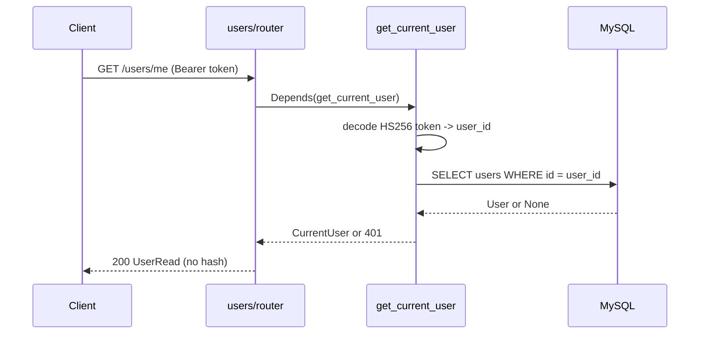

# Day 3 — Authentication & Profile Service — Implementation

**Feature folder:** `specs/feature/2026-11-19-day3-auth-users/`  
**Milestone:** M1 (see [specs/roadmap.md](../../roadmap.md))  
**Governed by:** [specs/constitution.md](../../constitution.md) and [specs/tech-stack.md](../../tech-stack.md)

---

## 1. Stack & Tooling
- Python 3.12 via uv; FastAPI/Pydantic v2; SQLAlchemy 2.0 sync; PyJWT HS256; `pwdlib[argon2]`.
- MySQL 8 via PyMySQL; tests against `taskqueue_test` through the Day 2 guarded harness.
- No new dependencies: all packages are already in `pyproject.toml`.

## 2. Architecture & File Structure
```
app/
  main.py                 # FastAPI entrypoint; include auth + users routers
  core/
    config.py             # SECRET_KEY, DATABASE_URL, ACCESS_TOKEN_EXPIRE_DAYS
    database.py           # Base, engine, DbSession, get_db, UTCDateTime, utcnow
    security.py           # NEW: Argon2 + JWT helpers
  models/
    users.py              # EXISTING: User model
    courses.py            # EXISTING
    tasks.py              # EXISTING
  auth/
    __init__.py           # NEW
    dependencies.py       # NEW: get_current_user, oauth2_scheme
    router.py             # NEW: /auth/register, /auth/login
  users/
    schemas.py            # NEW: UserCreate, UserRead, UserUpdate, Token
    router.py             # NEW: /users/me GET/PATCH/DELETE
  tasks/scoring.py        # FROZEN pure scoring engine
tests/
  conftest.py             # MODIFY: add client, make_user, auth_headers
  test_auth.py            # NEW
  test_users.py           # NEW
  test_core.py, test_scoring.py, test_migrations.py  # regression
```
Routers parse HTTP and map errors; `dependencies.py` owns identity; `security.py` owns cryptography. No service layer is introduced in Day 3 because there are no cross-resource business rules beyond owner-scoped self access.

## 3. Database Schema
**No schema change.** The existing `users` table is reused exactly as created in Day 2:

| Column | Type | Use in Day 3 |
|---|---|---|
| `id` | INT PK auto-increment | JWT `sub`, resolved to `User.id` |
| `username` | VARCHAR(50) unique/indexed | Lowercased login identifier |
| `email` | VARCHAR(320) unique/indexed | Lowercased login identifier |
| `hashed_password` | VARCHAR(255) | Argon2 hash; never serialized |
| `daily_study_hours` | DOUBLE | PATCH target, bounded 0.5–16.0 |
| `created_at` | DATETIME(6) UTC | Returned in `UserRead` |

Cascades from Day 2 remain authoritative: deleting a `User` cascades `courses` and `tasks`. No Alembic revision is generated.

## 4. Core Logic
```python
def hash_password(password: str) -> str:
    return PasswordHash.recommended().hash(password)

def verify_password(plain: str, hashed: str) -> bool:
    return PasswordHash.recommended().verify(plain, hashed)

def create_access_token(subject: int, expires_delta: timedelta | None = None) -> str:
    expire = datetime.now(timezone.utc) + (expires_delta or timedelta(days=settings.access_token_expire_days))
    return jwt.encode({"sub": str(subject), "exp": expire}, settings.secret_key, algorithm="HS256")

def decode_access_token(token: str) -> int:
    payload = jwt.decode(token, settings.secret_key, algorithms=["HS256"])
    return int(payload["sub"])
```
`get_current_user`: decode token → `int(sub)` → `db.query(User).filter(User.id == user_id).first()` → if missing or invalid, raise `401 {"detail":"Could not validate credentials"}` with `WWW-Authenticate: Bearer`. This is the single gateway (S-1); routes never read headers.

## 5. API Contracts
```jsonc
// POST /auth/register
// Request: { "username": "alex24", "email": "Alex@School.edu", "password": "securePassword123" }
// 201: { "id": 1, "username": "alex24", "email": "alex@school.edu", "daily_study_hours": 3.0, "created_at": "2026-11-17T12:00:00Z" }
// 409: { "detail": "Username already taken" } or { "detail": "Email already registered" }

// POST /auth/login  (OAuth2PasswordRequestForm: username=alex24 OR alex@school.edu, password=...)
// 200: { "access_token": "eyJ...", "token_type": "bearer" }
// 401: { "detail": "Incorrect username/email or password" }

// GET /users/me -> 200 UserRead
// PATCH /users/me  Request: { "daily_study_hours": 4.5 } -> 200 UserRead
// DELETE /users/me -> 204 No Content
```
All `/users/me` routes require `Authorization: Bearer <token>`.

## 6. Control Flow Sequence


## 7. Failure Handling & HTTP Exceptions
| Scenario | Status | Detail |
|---|---|---|
| Missing/invalid/expired Bearer token | 401 | `Could not validate credentials` + Bearer challenge |
| Token for deleted user | 401 | `Could not validate credentials` |
| Wrong username/email or password | 401 | `Incorrect username/email or password` |
| Duplicate username | 409 | `Username already taken` |
| Duplicate email | 409 | `Email already registered` |
| Bad username/email/password bounds | 422 | Pydantic validation error |
| `daily_study_hours` outside 0.5–16.0 | 422 | Pydantic validation error |

## 8. Migrations & Test Database Strategy
No Alembic revision in Day 3. Reuse `tests/conftest.py`: guarded `TEST_DATABASE_URL` ending in `_test`, Alembic upgrade once per session, autouse table cleanup. The `client` fixture overrides `app.core.database.get_db` with a session bound to `test_engine` so API calls hit `taskqueue_test`.
