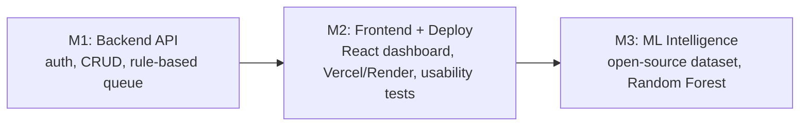

# Roadmap — Smart Student Task Prioritization Queue System

## Overview

## Milestone 1 — Backend API
**Workstreams:** project setup (uv, git, MySQL DBs + user, Alembic) · auth & users · task CRUD · priority engine (deadline + smart) · test suite.
**Detail:** `specs/feature/2026-11-17-milestone-1-backend/`
**Exit criteria:**
- [ ] `uv run alembic upgrade head` builds the schema on an empty MySQL database.
- [ ] Full flow works in `/docs`: register → authorize → CRUD → both queue sorts → delete account.
- [ ] Reference scores reproduce exactly (A = 20.2, B = 56.1, C = 64.5).
- [ ] Cross-user access returns 404 on every task route.
- [ ] `uv run pytest` green against `taskqueue_test`.
- [ ] Every constitution invariant checked in the M1 validation matrix.

## Milestone 2 — Frontend, Deployment & Usability Testing
**Workstreams:** React/Vite/TS/Tailwind dashboard (top tasks, full queue, sort toggle, score breakdown) · quick-add form · auth screens · CORS for the Vercel origin · deploy backend to Render + managed MySQL, frontend to Vercel · usability sessions.
**Exit criteria:**
- [ ] Deployed frontend talks to the deployed backend over HTTPS.
- [ ] A new tester can register and add a task in under 30 s (K-2).
- [ ] Usability sessions run with at least 3 testers; findings recorded.
- [ ] The owner uses it daily for a few weeks (feeds K-1).

## Milestone 3 — ML Intelligence
**Workstreams:** pick and document the open-source dataset · map it to the task schema (schema migration if needed) · Pandas feature pipeline (days until due, grade weight, effort, difficulty…) · train/evaluate `RandomForestRegressor` · serve predictions behind the same `compute_priority` interface with breakdown + baseline (Axiom 1).
**Exit criteria:**
- [ ] Dataset source, license, and feature mapping documented.
- [ ] The model beats the rule-based formula on a held-out set, using a metric fixed in the M3 spec (K-3).
- [ ] The API can switch between formula and model, falling back to the formula if the model is missing.
- [ ] All constitution invariants still hold.
